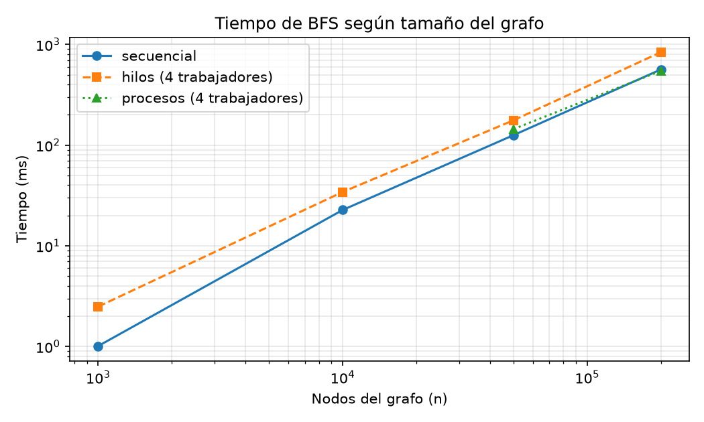
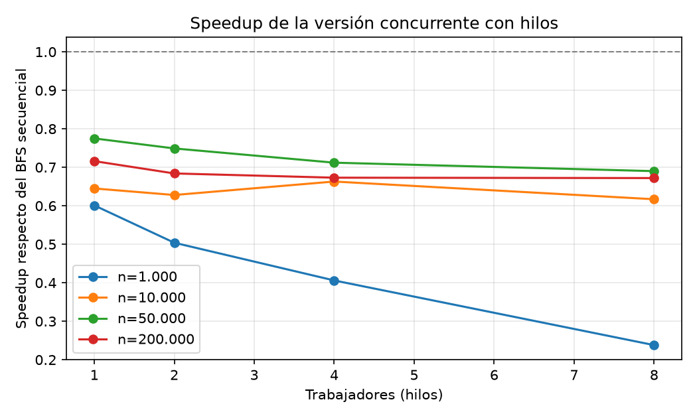
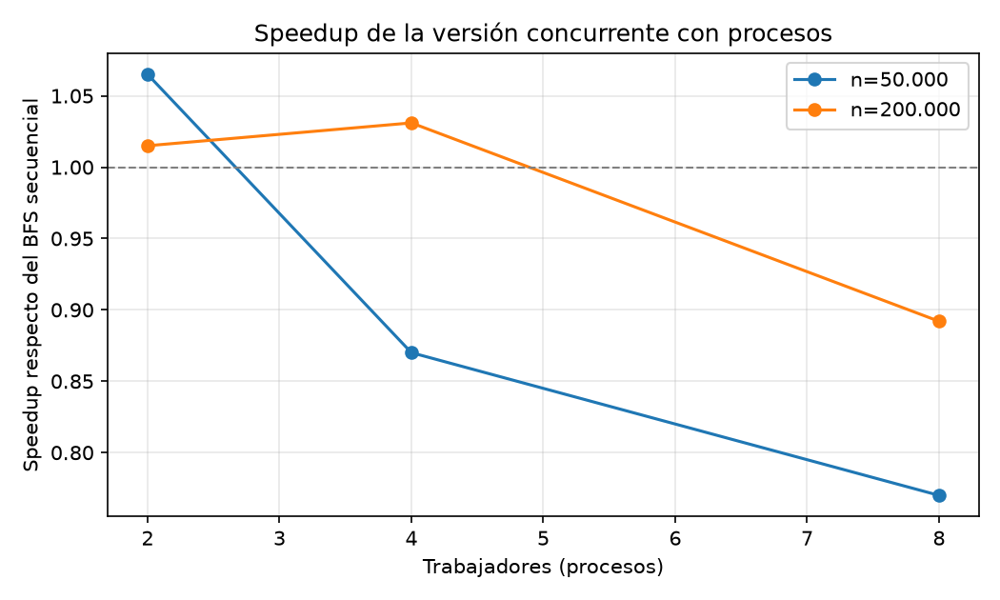

<div align="center">

# 🕸️ BFS Concurrente sobre Grafos

### Del BFS secuencial a un BFS paralelo por niveles: dependencias, condiciones de carrera y rendimiento real

<p>
  
  
  
  
  
</p>

**Trabajo Práctico — Sistemas Distribuidos y Paralelos**
Paula Vanina Chiecher · [Carlos Santiago Ledesma (@dekuprogramador)](https://github.com/dekuprogramador)

</div>

---

## 📑 Tabla de contenidos

- [¿De qué se trata?](#-de-qué-se-trata)
- [Características principales](#-características-principales)
- [Requisitos](#-requisitos)
- [Clonar el repositorio](#-clonar-el-repositorio)
- [Compilar / verificar el código](#-compilar--verificar-el-código)
- [Uso: todos los comandos explicados](#-uso-todos-los-comandos-explicados)
- [Estructura del proyecto](#-estructura-del-proyecto)
- [Cómo funciona el algoritmo](#-cómo-funciona-el-algoritmo)
  - [Representación del grafo](#1-representación-del-grafo)
  - [BFS secuencial (línea base)](#2-bfs-secuencial-línea-base)
  - [BFS concurrente por niveles](#3-bfs-concurrente-por-niveles)
  - [La condición de carrera](#4-la-condición-de-carrera-check-then-act)
  - [Estrategias de coordinación](#5-estrategias-de-coordinación)
  - [Verificación de correctitud](#6-verificación-de-correctitud)
- [Experimentos y resultados](#-experimentos-y-resultados)
- [Análisis de los resultados](#-análisis-de-los-resultados)
- [Conclusiones](#-conclusiones)
- [Subir el proyecto a GitHub](#-subir-el-proyecto-a-github)
- [Autores](#-autores)
- [Referencias](#-referencias)

---

## 🎯 ¿De qué se trata?

Este trabajo práctico toma el algoritmo de **búsqueda en anchura (BFS)** —clásico, secuencial y fácil de entender— y lo lleva a una versión **concurrente por niveles**, donde varios trabajadores expanden al mismo tiempo la frontera actual del recorrido.

El objetivo **no es solamente acelerar**: es entender y demostrar

- qué dependencias impone el algoritmo y qué partes se pueden paralelizar,
- qué estructuras de datos se comparten entre trabajadores,
- por qué dos trabajadores pueden descubrir el mismo nodo simultáneamente,
- y cómo se coordina el avance de nivel para que el resultado siga siendo **exactamente** el mismo que el secuencial.

Se cubren las cuatro actividades de la consigna:

| # | Actividad | Dónde está |
|---|-----------|------------|
| 1 | Lista de adyacencia y BFS secuencial | `grafos.py` |
| 2 | BFS concurrente por niveles | `grafos.py` |
| 3 | Reunión y eliminación de duplicados antes de avanzar de nivel | `grafos.py` |
| 4 | Comparación de nodos visitados, distancias y tiempos | `experimento.py` |

Todo el código está en **Python 3**, usa **solo la biblioteca estándar** para el algoritmo y es **reproducible** (semilla fija `2026`).

---

## ✨ Características principales

- 🧩 **Grafo por lista de adyacencia** — memoria `O(n + m)`, ideal para grafos ralos.
- ⚡ **BFS secuencial** con cola FIFO como línea base.
- 🔀 **BFS concurrente por niveles** con barrera de sincronización al final de cada nivel.
- 🧵 **Un mismo diseño para hilos y procesos** (`ThreadPoolExecutor` / `ProcessPoolExecutor`).
- 🛡️ **Libre de carreras por construcción**: los trabajadores no escriben estado compartido.
- 🧪 **Demostración reproducible** de la condición de carrera *check-then-act*.
- ✅ **Verificación de correctitud** contra la línea base y contra propiedades matemáticas del BFS.
- 📊 **Experimento automatizado**: CSV de resultados + 3 gráficos PNG.
- 🔁 **Semilla fija** para que cualquier persona obtenga los mismos grafos.

---

## 📋 Requisitos

| Requisito | Versión | ¿Obligatorio? |
|-----------|---------|---------------|
| [Python](https://www.python.org/downloads/) | 3.9 o superior | ✅ Sí |
| [matplotlib](https://matplotlib.org/) | 3.5 o superior | ⚠️ Solo para generar los gráficos |

> 💡 El núcleo del trabajo (`grafos.py`) usa **únicamente la biblioteca estándar**. Si no instalás `matplotlib`, el experimento corre igual y simplemente omite los PNG.

Verificá tu instalación:

```bash
python --version
pip --version
```

---

## 📥 Clonar el repositorio

Reemplazá `PaulaChiecher` en caso de que el repositorio esté en otra cuenta:

```bash
git clone https://github.com/PaulaChiecher/SistemasDistribuidosyParalelos.git
cd SistemasDistribuidosyParalelos
```

### Crear el entorno virtual e instalar dependencias

**Windows (PowerShell):**

```powershell
python -m venv .venv
.\.venv\Scripts\Activate.ps1
pip install -r requirements.txt
```

**Linux / macOS:**

```bash
python3 -m venv .venv
source .venv/bin/activate
pip install -r requirements.txt
```

**¿Qué hace cada comando?**

| Comando | Para qué sirve |
|---------|----------------|
| `git clone <url>` | Descarga una copia completa del repositorio (código, historial e imágenes) en una carpeta local. |
| `cd SistemasDistribuidosyParalelos` | Entra a la carpeta del proyecto. Todos los comandos siguientes se ejecutan desde ahí. |
| `python -m venv .venv` | Crea un **entorno virtual** aislado en la carpeta `.venv`, para no instalar dependencias globales en tu sistema. |
| `.\.venv\Scripts\Activate.ps1` | Activa el entorno virtual en Windows. El prompt muestra `(.venv)`. |
| `source .venv/bin/activate` | Activa el entorno virtual en Linux/macOS. |
| `pip install -r requirements.txt` | Instala las dependencias listadas en `requirements.txt` (en este caso, `matplotlib`). |

> 🪟 **Si PowerShell bloquea la activación** con un error de *execution policy*, ejecutá una vez:
> `Set-ExecutionPolicy -Scope CurrentUser RemoteSigned`
>
> 🐧 En Linux/macOS también podés usar `python3` en lugar de `python`.

---

## 🛠️ Compilar / verificar el código

Python es un lenguaje **interpretado**: no existe un paso de compilación como en C o Java. El código se ejecuta directamente con el intérprete.

Aun así, es buena práctica **verificar que todos los archivos compilen** (es decir, que no tengan errores de sintaxis) antes de entregar o subir el proyecto:

```bash
python -m compileall -q .
```

| Comando | Para qué sirve |
|---------|----------------|
| `python -m compileall -q .` | Recorre todos los `.py` del proyecto y verifica que compilen a *bytecode*. `-q` muestra solo los errores. No genera un ejecutable: es un chequeo de sintaxis. |
| `python -m py_compile grafos.py experimento.py` | Alternativa: verifica únicamente esos dos archivos. |

Si no imprime nada, **todo está correcto**. ✅

> 🧠 Los archivos `.pyc` que genera viven en `__pycache__/`, que está excluido por `.gitignore`.

---

## ▶️ Uso: todos los comandos explicados

### 1) Demostración, traza y pruebas de correctitud

```bash
python grafos.py
```

**¿Para qué sirve?** Ejecuta un ejemplo completo y autocontenido:

1. Imprime la **lista de adyacencia** del grafo de ejemplo (10 nodos, 14 aristas).
2. Corre el **BFS secuencial** desde el nodo `0` y muestra las distancias.
3. Corre el **BFS concurrente con 2 trabajadores** mostrando una **traza paso a paso** por nivel: qué trozo recibió cada trabajador, qué descubrió y cómo queda la frontera tras la unión.
4. Ejecuta la **demostración de la condición de carrera**, comparando la versión ingenua (sin protección) con la versión protegida con `lock`.
5. Corre las **pruebas de correctitud** sobre grafos de 50, 1.000 y 5.000 nodos, verificando que el resultado concurrente coincide con el secuencial para 1, 2, 3, 4 y 8 trabajadores.

Salida esperada (resumida):

```text
=== BFS secuencial desde 0 ===
  distancias: [0, 1, 1, 1, 2, 2, 2, 3, 3, 4]

=== BFS concurrente por niveles (2 trabajadores) ===
  Nivel 0 -> 1
    frontera                : [0]
    trabajador 1: trozo [0] -> descubre [1, 2, 3]
    unión sin duplicados    : [1, 2, 3]
    nuevos (no visitados)   : [1, 2, 3]
  ...

=== Demostración de la condición de carrera ===
  sin protección : siguiente frontera = [3, 3]   (nodo 3 duplicado)
  con lock       : siguiente frontera = [3]

=== Pruebas de corrección ===
  ejemplo pequeño: OK
  n=   50, m=   120: concurrente == secuencial con 1,2,3,4,8 trabajadores: OK
  n= 1000, m=  3000: concurrente == secuencial con 1,2,3,4,8 trabajadores: OK
  n= 5000, m= 20000: concurrente == secuencial con 1,2,3,4,8 trabajadores: OK

Todas las pruebas pasaron.
```

> ⏱️ Tarda pocos segundos. Es la forma más rápida de comprobar que todo funciona.

---

### 2) Experimento completo

```bash
python experimento.py
```

**¿Para qué sirve?** Corre el *benchmark* completo del trabajo:

- Genera grafos aleatorios **conexos** con `m = 5n` aristas para
  `n ∈ {1.000, 10.000, 50.000, 200.000}`, con semilla `2026`.
- Mide la **mediana de 5 repeticiones** con ejecución de calentamiento previa.
- Compara:
  - BFS **secuencial**,
  - BFS concurrente con **1, 2, 4 y 8 hilos**,
  - BFS concurrente con **2, 4 y 8 procesos** (solo desde `n = 50.000`, donde crear procesos se justifica).
- Verifica que **todas** las configuraciones den el mismo vector de distancias que el secuencial.
- Guarda **`resultados.csv`** y genera **tres gráficos PNG**.

**Archivos que produce:**

| Archivo | Contenido |
|---------|-----------|
| `resultados.csv` | Datos crudos: `n`, `m`, modo, trabajadores, visitados, distancia máxima, tiempo (ms), speedup, correctitud y candidatos duplicados. |
| `grafico_tiempo_vs_tamano.png` | Tiempo vs. tamaño del grafo, en escala log-log. |
| `grafico_speedup_hilos.png` | Speedup de la versión con hilos según cantidad de trabajadores. |
| `grafico_speedup_procesos.png` | Speedup de la versión con procesos según cantidad de trabajadores. |

> ⏱️ Puede tardar **varios minutos**, sobre todo en el grafo de 200.000 nodos.

---

### 3) Experimento rápido (modo de prueba)

```bash
python experimento.py --rapido
```

**¿Para qué sirve?** Corre exactamente el mismo experimento pero solo con los tamaños chicos (`n = 1.000` y `n = 10.000`), sin la etapa de procesos. Sirve para **verificar que todo funciona** antes de lanzar el experimento completo.

| Bandera | Efecto |
|---------|--------|
| `--rapido` | Usa `TAMANIOS_RAPIDO` en lugar de `TAMANIOS_COMPLETO`. Termina en segundos. |

> ⚠️ Este comando **sobrescribe** `resultados.csv` y los gráficos con los datos del modo rápido. Si querés conservar los resultados del informe completo, volvé a correr `python experimento.py`.

---

### 4) Resumen de comandos

| Comando | Qué hace | Duración aproximada |
|---------|----------|---------------------|
| `python grafos.py` | Ejemplo con traza + demo de carrera + pruebas de correctitud | segundos |
| `python experimento.py --rapido` | Benchmark reducido (2 tamaños) | segundos |
| `python experimento.py` | Benchmark completo (4 tamaños, hilos y procesos) | varios minutos |
| `python -m compileall -q .` | Verifica sintaxis de todos los `.py` | segundos |

---

## 📂 Estructura del proyecto

```text
SistemasDistribuidosyParalelos/
├── grafos.py                              # Algoritmo: grafo, BFS secuencial y concurrente, verificación
├── experimento.py                         # Benchmark, CSV y gráficos
├── resultados.csv                         # Datos crudos de las mediciones del informe
├── grafico_tiempo_vs_tamano.png           # Tiempo vs. tamaño (log-log)
├── grafico_speedup_hilos.png              # Speedup con hilos
├── grafico_speedup_procesos.png           # Speedup con procesos
├── Informe_TP_Grafos_Concurrentes.docx    # Informe completo del TP
├── requirements.txt                       # Dependencias (matplotlib)
├── .gitignore                             # Excluye __pycache__, entornos virtuales, etc.
└── README.md                              # Este archivo
```

### Descripción de cada archivo

| Archivo | Rol |
|---------|-----|
| **`grafos.py`** | Núcleo del trabajo. Contiene `crear_grafo`, `generar_grafo`, `bfs_secuencial`, `bfs_concurrente`, `expandir_trozo`, `partir`, `verificar`, `demo_carrera` y `ejemplo`. |
| **`experimento.py`** | Orquesta las mediciones y genera los entregables. Importa todo desde `grafos.py`. |
| **`resultados.csv`** | Evidencia cruda del experimento, lista para abrir en Excel, pandas o cualquier planilla. |
| **`Informe_TP_Grafos_Concurrentes.docx`** | Documento académico con marco teórico, diseño, trazas, tablas y análisis. |

---

## 🧠 Cómo funciona el algoritmo

### 1) Representación del grafo

Se usa una **lista de adyacencia**: `adj[u]` es la lista de vecinos de `u`.

```python
def crear_grafo(n, aristas):
    adj = [[] for _ in range(n)]
    for u, v in aristas:
        adj[u].append(v)
        adj[v].append(u)   # no dirigido: se guarda dos veces
    return adj
```

| Representación | Memoria | Costo de recorrer vecinos de `u` |
|----------------|---------|----------------------------------|
| **Lista de adyacencia** ✅ | `O(n + m)` | `O(grado(u))` |
| Matriz de adyacencia ❌ | `O(n²)` | `O(n)` |

Para grafos ralos como los del experimento (`m ≈ 5n`), la matriz sería inviable: con `n = 200.000` necesitaría 40.000 millones de celdas. Por eso se elige la lista.

Los grafos del experimento se generan **conexos y reproducibles**: primero se arma un árbol aleatorio (cada nodo `v` se conecta a uno anterior elegido al azar, lo que garantiza conectividad) y después se agregan aristas extra al azar sin repetir hasta llegar a `m`. Con la misma semilla, siempre se obtiene el mismo grafo.

### 2) BFS secuencial (línea base)

```python
def bfs_secuencial(adj, origen):
    dist = [-1] * len(adj)
    dist[origen] = 0
    cola = deque([origen])
    while cola:
        u = cola.popleft()
        for v in adj[u]:
            if dist[v] == -1:          # todavía no descubierto
                dist[v] = dist[u] + 1
                cola.append(v)
    return dist
```

`dist[v]` guarda la **cantidad mínima de aristas** entre el origen y `v`, o `-1` si `v` no es alcanzable.

¿Por qué da distancias mínimas? Porque la cola es **FIFO**: los nodos salen en orden no decreciente de distancia. La primera vez que se descubre un nodo, se lo descubre por un camino mínimo.

**Complejidad:** `O(n + m)` en tiempo y `O(n)` de memoria adicional — cada nodo entra a la cola una vez y cada arista se examina dos veces (una por extremo).

### 3) BFS concurrente por niveles

#### ¿Qué se puede paralelizar?

| Relación | ¿Paralelo? | Motivo |
|----------|------------|--------|
| **Dentro de un nivel** | ✅ Sí | Expandir `u` no depende de expandir otro nodo del mismo nivel. |
| **Entre niveles** | ❌ No | La frontera del nivel `d + 1` recién se conoce cuando terminó todo el nivel `d`. |

De ahí surge la necesidad de una **barrera de sincronización al final de cada nivel**.

#### Diseño paralelo (DAOM)

| Etapa | Decisión en este TP |
|-------|---------------------|
| **Descomposición** | Por datos: cada nodo de la frontera es una tarea independiente que solo mira a sus vecinos. |
| **Asignación** | Estática por nivel: la frontera se parte en `k` trozos contiguos de tamaño casi igual (`k` = cantidad de trabajadores). |
| **Orquestación** | Barrera al final de cada nivel + reunión secuencial de resultados por el coordinador. |
| **Mapeo** | Pool de `k` hilos o de `k` procesos; el sistema operativo los distribuye entre los núcleos. |

#### La decisión clave: nadie escribe estado compartido

Los trabajadores **no escriben** en ninguna estructura compartida. Cada uno recibe un trozo de la frontera, **lee** el grafo y devuelve su **conjunto local** de vecinos descubiertos. Únicamente el **coordinador** (hilo principal) lee y modifica `dist`, y lo hace **entre niveles**.

```python
def expandir_trozo(trozo):              # TRABAJADOR: función pura
    candidatos = set()
    for u in trozo:
        candidatos.update(_ADJ[u])
    return candidatos
```

```python
def bfs_concurrente(adj, origen, ejecutor, trabajadores):
    dist = [-1] * len(adj)
    dist[origen] = 0
    frontera = [origen]
    nivel = 0

    while frontera:
        trozos = partir(frontera, trabajadores)

        # Fase paralela: cada trabajador expande su trozo
        resultados = list(ejecutor.map(expandir_trozo, trozos))  # ← barrera

        # Fase secuencial: reunir y eliminar duplicados
        todos = set()
        for r in resultados:
            todos.update(r)
        nueva = [v for v in todos if dist[v] == -1]   # descartar visitados
        nivel += 1
        for v in nueva:
            dist[v] = nivel

        frontera = nueva

    return dist, est
```

Ventajas de este esquema:

- ✅ **Correcto por construcción**: no hay escrituras concurrentes, así que no hay carreras.
- ✅ **Simple de razonar y probar**.
- ✅ **La misma función de trabajador sirve** para hilos y para procesos.

Su costo: la **unión y el filtrado son secuenciales** (limitan el speedup según la Ley de Amdahl) y cada trabajador devuelve más datos de los necesarios.

#### Traza real con 2 trabajadores

| Nivel | Frontera | Trabajador 1 | Trabajador 2 | Nuevos tras la unión |
|-------|----------|--------------|--------------|----------------------|
| 0 → 1 | `[0]` | `[0] → {1, 2, 3}` | — | `[1, 2, 3]` |
| 1 → 2 | `[1, 2, 3]` | `[1, 2] → {0, 4, 5}` | `[3] → {0, 5, 6}` | `[4, 5, 6]` |
| 2 → 3 | `[4, 5, 6]` | `[4, 5] → {1, 2, 3, 7, 8}` | `[6] → {3, 8}` | `[7, 8]` |
| 3 → 4 | `[7, 8]` | `[7] → {4, 5, 9}` | `[8] → {5, 6, 9}` | `[9]` |
| 4 → 5 | `[9]` | `[9] → {7, 8}` | — | `[]` |

👀 En el nivel **1 → 2**, el nodo `5` lo descubren **ambos** trabajadores. La unión lo deja una sola vez.

### 4) La condición de carrera (check-then-act)

El nodo `3` del grafo mínimo `0–1, 0–2, 1–3, 2–3` tiene dos vecinos (`1` y `2`) en la misma frontera. Si cada trabajador hace:

```python
if dist[v] == -1:      # 1) comprobar
    dist[v] = 2        # 2) escribir
```

ambos pueden **comprobar antes de que el otro escriba**, concluir que `v` es nuevo y agregarlo dos veces a la frontera siguiente. Es el clásico problema **TOCTOU** (*time-of-check to time-of-use*), el mismo de la Actividad 9 de la guía.

El código lo demuestra de forma **reproducible** usando una `threading.Barrier(2)` que fuerza la intercalación mala:

| Versión | Siguiente frontera |
|---------|--------------------|
| Sin protección (*check-then-act*) | `[3, 3]` ← nodo duplicado ❌ |
| Con `lock` y re-chequeo dentro de la sección crítica | `[3]` ✅ |

**¿Por qué importa?** Con duplicados, el vector de distancias puede seguir siendo correcto, pero:

- se **repite trabajo** en todos los niveles posteriores (en grafos densos, el crecimiento es enorme),
- se **falsean contadores y estadísticas**,
- y la frontera puede crecer sin control.

En el grafo más grande (`n = 200.000`, `m = 1.000.000`) con 8 trabajadores se descartaron **987.636 candidatos repetidos**, cerca del **49 % de las aristas examinadas**.

### 5) Estrategias de coordinación

| Estrategia | Cómo funciona | Costo / riesgo |
|------------|---------------|----------------|
| **Lock + re-chequeo** | Sección crítica: `if dist[v] == -1: escribir`. | Serializa en el punto más usado; mucha contención. |
| **Operación atómica (CAS)** | Marcar `v` como visitado con una instrucción indivisible; solo gana uno. | Necesita soporte del lenguaje (C/Java/atomics); no existe en Python estándar. |
| **Partición por propietario** | Cada nodo pertenece a un trabajador (`v % k`); los demás le envían `v`. | Comunicación entre trabajadores; es el enfoque de MPI. |
| **Reunión por el coordinador** ✅ | Los trabajadores devuelven candidatos; el coordinador hace la unión y filtra visitados. | Parte secuencial (Amdahl) y mayor volumen de datos devueltos. |

Se eligió la **reunión por el coordinador** porque es correcta por construcción, simple de razonar y probar, y funciona igual con hilos o procesos.

### 6) Verificación de correctitud

La corrección se comprobó de **tres maneras independientes**:

1. **Igualdad con la línea base:** para cada grafo y para 1, 2, 3, 4 y 8 trabajadores, el vector de distancias concurrente es **idéntico** al secuencial (`assert d == ref`).
2. **Propiedades que definen las distancias de BFS** (función `verificar`):
   - **(a)** `dist[origen] == 0`;
   - **(b)** para toda arista `(u, v)`: `|dist[u] - dist[v]| ≤ 1` → impide distancias **demasiado grandes**;
   - **(c)** todo nodo con `dist = d > 0` tiene un vecino con `dist = d - 1` → impide distancias **demasiado chicas** (garantiza que existe un camino real).
   Juntas, (b) y (c) **caracterizan** las distancias mínimas.
3. **Argumento inductivo:** si la frontera del nivel `d` contiene exactamente los nodos a distancia `d`, entonces la unión de sus vecinos menos los ya visitados son exactamente los nodos a distancia `d + 1`. La barrera impide armar el nivel `d + 1` con información incompleta, y que solo el coordinador escriba `dist` elimina las carreras.

---

## 📊 Experimentos y resultados

### Metodología

- Grafos aleatorios conexos con `m = 5n` aristas, `n ∈ {1.000; 10.000; 50.000; 200.000}`, semilla `2026`, origen en el nodo `0`.
- Cada medición es la **mediana de 5 repeticiones**, con una ejecución de **calentamiento** previa (el pool ya está creado; no se mide su arranque).
- Reloj: `time.perf_counter()`.
- Equipo de medición: **AMD64 (AuthenticAMD), 12 núcleos lógicos, Python 3.14.7**.

### Nodos visitados y distancias mínimas

| Nodos (n) | Aristas (m) | Visitados | Distancia máxima | ¿Concurrente = secuencial? |
|-----------|-------------|-----------|------------------|----------------------------|
| 1.000 | 5.000 | 1.000 | 4 | ✅ Sí, en todas las configuraciones |
| 10.000 | 50.000 | 10.000 | 6 | ✅ Sí, en todas las configuraciones |
| 50.000 | 250.000 | 50.000 | 6 | ✅ Sí, en todas las configuraciones |
| 200.000 | 1.000.000 | 200.000 | 7 | ✅ Sí, en todas las configuraciones |

Como los grafos son conexos, **se visitan todos los nodos**. La distancia máxima crece muy lentamente (de 4 a 7 al multiplicar por 200 el tamaño): son grafos de **mundo pequeño**. Consecuencia para el paralelismo: **pocas barreras** (pocos niveles) pero **fronteras enormes** en los niveles intermedios (en el grafo más grande, la frontera máxima supera los **119.000 nodos**), es decir, mucho trabajo independiente por nivel.

### Tiempos (mediana, ms)

| Nodos (n) | Secuencial | Hilos k=2 | Hilos k=4 | Hilos k=8 | Procesos k=2 | Procesos k=4 |
|-----------|-----------:|----------:|----------:|----------:|-------------:|-------------:|
| 1.000 | **1,0** | 2,0 | 2,5 | 4,3 | — | — |
| 10.000 | **22,7** | 36,1 | 34,3 | 36,8 | — | — |
| 50.000 | **125,7** | 167,8 | 176,6 | 182,1 | 118,0 | 144,4 |
| 200.000 | **563,6** | 824,4 | 837,7 | 839,1 | 555,1 | **546,5** |

### Speedup (`tiempo secuencial / tiempo concurrente`)

> Valores **menores que 1** significan que la versión concurrente es **más lenta** que la secuencial.

| Nodos (n) | Hilos k=1 | Hilos k=2 | Hilos k=4 | Hilos k=8 | Procesos k=2 | Procesos k=4 | Procesos k=8 |
|-----------|----------:|----------:|----------:|----------:|-------------:|-------------:|-------------:|
| 1.000 | 0,60x | 0,50x | 0,41x | 0,24x | — | — | — |
| 10.000 | 0,64x | 0,63x | 0,66x | 0,62x | — | — | — |
| 50.000 | 0,77x | 0,75x | 0,71x | 0,69x | **1,07x** | 0,87x | 0,77x |
| 200.000 | 0,72x | 0,68x | 0,67x | 0,67x | 1,02x | **1,03x** | 0,89x |

### Gráficos

<p align="center">
  
</p>

<p align="center">
  
  
</p>

---

## 🔍 Análisis de los resultados

**El tiempo crece de forma lineal con `n + m`** en las tres versiones: en el gráfico log-log las curvas son casi rectas de pendiente 1, tal como predice la complejidad `O(n + m)`.

**Los hilos no aceleran.** Con 1 a 8 hilos el speedup queda entre **0,24x y 0,77x**, aun con 12 núcleos lógicos disponibles. La causa es el **GIL de CPython**: aunque haya núcleos libres, dos hilos no ejecutan bytecode de Python a la vez, así que solo se intercalan. Además, este diseño agrega trabajo que el secuencial no tiene (armar trozos, conjuntos locales, unir y filtrar): incluso con **1 hilo** el tiempo es entre 1,3 y 1,7 veces el del secuencial.

**Más hilos no mejoran el tiempo.** En el grafo de 200.000 nodos el speedup queda casi plano (0,72x → 0,68x → 0,67x → 0,67x para k = 1, 2, 4 y 8) porque el GIL serializa la ejecución. En el grafo de 1.000 nodos cae de 0,60x a 0,24x porque el **costo fijo de repartir y coordinar** domina sobre un trabajo de apenas ~1 ms.

**Los procesos superan al secuencial, pero por muy poco.** Evitan el GIL y usan varios núcleos: el mejor caso es **1,07x con 2 procesos** en `n = 50.000` (118,0 ms vs. 125,7 ms) y **1,03x con 4 procesos** en `n = 200.000` (546,5 ms vs. 563,6 ms). Son ganancias del **2 % al 7 %**, del orden de la variabilidad de una medición con 5 repeticiones: lo honesto es decir que **empatan o ganan levemente**. Con 8 procesos el speedup cae a 0,77x y 0,89x.

**¿Por qué tan poco?** Dos límites:

1. **Ley de Amdahl:** la unión, el filtrado y la asignación de distancias los hace solo el coordinador, de forma secuencial. Esa fracción limita el speedup aunque haya infinitos trabajadores.
2. **Costo de comunicación:** con procesos, los resultados de cada trabajador deben serializarse y devolverse en **cada nivel**, un overhead que crece con `k`.

---

## 🏁 Conclusiones

- BFS tiene **paralelismo natural dentro de cada nivel** y **dependencia estricta entre niveles**; la barrera por nivel es la forma directa de respetarla.
- El problema central de coordinación es que **un mismo nodo puede ser descubierto por varios trabajadores a la vez**. Es una carrera *check-then-act*: se demostró, se reprodujo y se resolvió con una estrategia de reunión sin escrituras compartidas.
- La **correctitud se verificó** contra la versión secuencial en todas las configuraciones y mediante propiedades matemáticas independientes de las distancias mínimas.
- En el equipo de medición, la versión con hilos es **entre 1,3 y 4,2 veces más lenta**, y la de procesos queda entre **0,77x y 1,07x**: empata o gana apenas con 2 procesos (y con 4 en el grafo más grande).
- **No es un defecto de la idea:** muestra que paralelizar exige hardware paralelo, un runtime que lo aproveche y suficiente trabajo por nivel para amortizar la coordinación. **“Más trabajadores” no equivale a “más rápido”.**

### Mejoras posibles

- Un runtime **sin GIL** o un lenguaje compilado con `atomics` (C/OpenMP).
- **Partición por propietario con MPI** para grafos que no entran en una sola máquina.
- Un **BFS híbrido top-down / bottom-up** que cambie de dirección cuando la frontera es muy grande.

---

## 🚀 Subir el proyecto a GitHub

Si todavía no existe el repositorio remoto, estos son los pasos (desde la carpeta del proyecto):

```bash
git init
git add .
git commit -m "TP: BFS secuencial y concurrente sobre grafos"
git branch -M main
git remote add origin https://github.com/PaulaChiecher/SistemasDistribuidosyParalelos.git
git push -u origin main
```

| Comando | Para qué sirve |
|---------|----------------|
| `git init` | Inicializa un repositorio Git local en la carpeta. |
| `git add .` | Prepara todos los archivos (respetando `.gitignore`) para el commit. |
| `git commit -m "..."` | Guarda una instantánea de los cambios con un mensaje descriptivo. |
| `git branch -M main` | Renombra la rama actual a `main` (nombre estándar en GitHub). |
| `git remote add origin <url>` | Vincula el repo local con el remoto de GitHub. |
| `git push -u origin main` | Sube la rama `main` y deja `origin/main` como destino por defecto. |

### Agregar a un colaborador

El compañero **[@dekuprogramador](https://github.com/dekuprogramador)** debe quedar como colaborador con permisos de escritura:

**Opción A — desde la web:** `Settings` → `Collaborators and teams` → `Add people` → buscar `dekuprogramador` → rol **Write** → enviar invitación.

**Opción B — con GitHub CLI:**

```bash
gh api -X PUT repos/PaulaChiecher/SistemasDistribuidosyParalelos/collaborators/dekuprogramador -f permission=push
```

> La invitación debe ser **aceptada** por `@dekuprogramador` desde su cuenta o desde el mail de GitHub.

---

## 👥 Autores

<table>
  <tr>
    <td align="center">
      <b>Paula Vanina Chiecher</b><br>
      <sub>Desarrollo, experimentos y análisis</sub>
    </td>
    <td align="center">
      <a href="https://github.com/dekuprogramador">
        <br>
        <b>Carlos Santiago Ledesma</b><br>
        <sub>@dekuprogramador</sub>
      </a>
    </td>
  </tr>
</table>

Trabajo Práctico realizado en conjunto para la cátedra **Sistemas Distribuidos y Paralelos**.

---

## 📚 Referencias

- Aho, A. V., Hopcroft, J. E., & Ullman, J. D. — *Data Structures and Algorithms* (BFS y representación de grafos).
- Herlihy, M., & Shavit, N. — *The Art of Multiprocessor Programming* (condiciones de carrera, *check-then-act*, sincronización).
- Mattson, T. G., Sanders, B. A., & Massingill, B. L. — *Patterns for Parallel Programming* (DAOM: descomposición, asignación, orquestación y mapeo).
- Documentación oficial de Python — [`concurrent.futures`](https://docs.python.org/3/library/concurrent.futures.html) · [`threading`](https://docs.python.org/3/library/threading.html).
- Guía de la cátedra — Unidad 2 (diseño de programas paralelos) y Actividad 9 (condición de carrera *check-then-act*).

---

<div align="center">

Hecho con ☕ y `concurrent.futures` — **2026**

</div>
